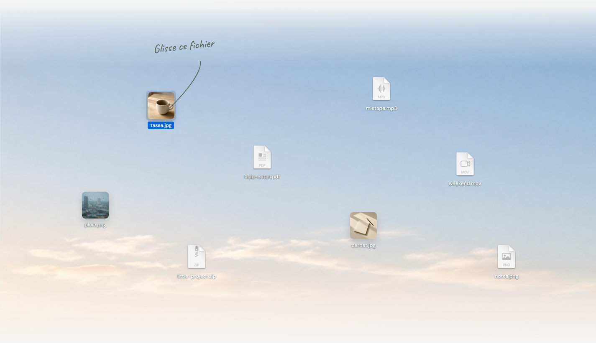
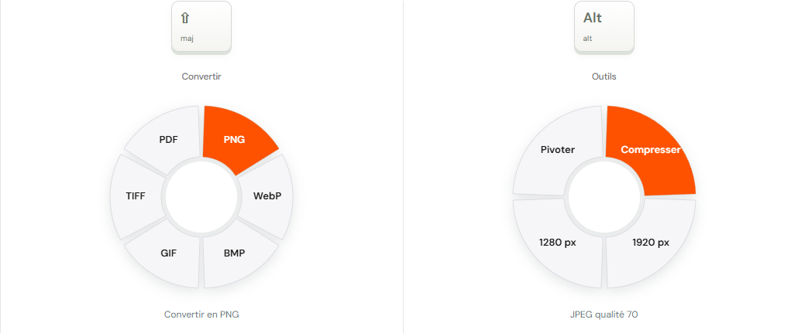
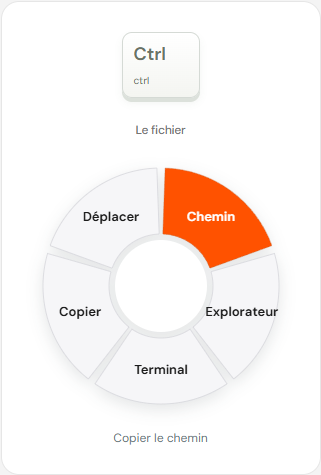

# Cinder

Convertisseur local pour Windows. Sur le bureau ou dans l'Explorateur de fichiers, maintiens une touche : la roue s'affiche sous le curseur, et son contenu dépend du fichier qui est là. Déplace la souris sur un segment, puis relâche. Le fichier d'origine reste en place. Le résultat est écrit à côté.

## Lancer

Un raccourci **Cinder** est posé sur le bureau et dans le menu Démarrer. Un clic ouvre le tableau de bord : les minutes gagnées, et un bouton ON / OFF. L'icône du raccourci est la roue. Cinder reste aussi dans les icônes en bas. Le clic droit propose Pause et Quitter. Une seule instance tourne à la fois.

Le journal est dans `%LOCALAPPDATA%\Cinder\cinder.log`.

## Geste

Clique d'abord le bureau ou une fenêtre de l'Explorateur pour qu'elle soit au premier plan. Le fichier sous le curseur est celui de la roue.

- Maintiens **Maj** : les formats du fichier (image, vidéo, audio, sous-titre, archive, tableur, texte, EPUB, PDF, document ou diapositives).
- Maintiens **Alt** : les outils automatiques de ce type. Une image se compresse, se réduit ou pivote. Une vidéo se compresse, perd son son ou donne une image. Un audio se compresse ou se normalise. Une archive s'extrait.
- Maintiens **Ctrl** : copier le chemin, afficher dans l'Explorateur, terminal, copier, déplacer.

La roue suit le moment où la touche est enfoncée. Le segment sous la souris est orange. Relâcher la touche sur un segment applique l'action. Relâcher au centre laisse la roue ouverte : un clic sur un segment confirme, Échap ferme.

Maj, Alt et Ctrl restent utilisables pour leurs raccourcis. Si une autre touche arrive, la roue se ferme. Un clic au centre la ferme aussi. Un clic sur un segment applique l'action.

Dans l'Explorateur, le maintien agit sur le fichier sous le curseur. Glisser un fichier puis appuyer sur Maj, Alt ou Ctrl ouvre aussi la roue, jusqu'au relâchement de la souris.

## Limites

Tout reste sur la machine. La vidéo et l'audio passent par ffmpeg, qui doit être installé. Une image se convertit en JPG, PNG, WebP, BMP, GIF, TIFF ou PDF, sur Maj comme sur Alt. Un PDF se convertit en texte, HTML, DOCX, EPUB, PNG, JPG, PPTX ou XLSX, sur Maj comme sur Alt. Alt le compresse, le sépare ou en écrit aussi les métadonnées. Un DOCX, un ODT ou un RTF se convertit en texte, HTML, PDF ou EPUB, sur Maj comme sur Alt. Un HTML, un TXT ou un Markdown se convertit aussi en PDF, DOCX ou EPUB. Un EPUB se convertit aussi en PDF ou DOCX. Un classeur Excel, CSV ou ODS se convertit en ODS, CSV, TSV ou PDF. Des diapositives PPTX se convertissent en PDF, JPG ou PNG, une image par diapositive. Pas encore de HEIC, d'AVIF ni de PAGES. Rogner, caviarder et annoter ne sont pas dans cette version. La roue au clavier s'ouvre quand le bureau ou l'Explorateur de fichiers est au premier plan. L'application ne doit pas être lancée en administrateur.
